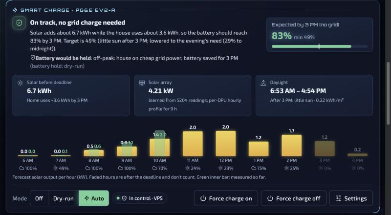

# Home Power

A smarter controller for an **EcoFlow Smart Home Panel 2** with **DELTA Pro Ultra** batteries. It watches the panel every minute, plans grid charging from the solar forecast, keeps two battery stacks balanced, and shows everything on one dashboard.


## Why

EcoFlow's built-in modes work for a simple setup. They fall short when:

- **The two stacks differ.** If they have different capacities or get different sun, one fills up and wastes solar while the other still has room.
- **The weather changes.** The panel doesn't use a forecast, so on a cloudy day the battery can run out before the expensive evening hours end.
- **The panel acts on its own.** Storm mode and the panel's own solar reserve can charge from the grid at 8 kW, and the panel sometimes ignores a "stop charging" command.

## What it does

- **Plans each day from the forecast.** It estimates your solar from the [Open-Meteo](https://open-meteo.com) forecast and from what your panels have actually produced. If that won't carry the house through peak hours, it charges from the grid during cheap off-peak hours, and only as much as the evening needs.
- **Balances two stacks.** When one stack is much fuller or about to overflow with solar, it pauses the other, so the house draws from the fuller one.
- **Catches the panel.** If the panel charges from the grid without being told to, or ignores a stop command, the controller sets it back and logs it.
- **Raises the reserve before wind.** When strong gusts are forecast, it keeps extra charge in case the power goes out.
- **Reports every day:** solar, battery, grid, home use, losses and money saved.




## Before you start

- **Hardware:** a Smart Home Panel 2 with one to three DELTA Pro Ultra stacks; capacity and charge power are read from the panel. Balancing between stacks needs DPUs in slots 1 and 2. Other EcoFlow panels use different commands and won't work without changes.
- **An EcoFlow developer account** for an access key and secret key. Apply at [developer.ecoflow.com](https://developer.ecoflow.com); approval can take a few days.
- **Your rate plan:** **PG&E EV2-A** in California time out of the box. Any other time-of-use plan is one JSON file; see [Your rate plan](#your-rate-plan).
- **Python 3.11+** or **Docker**. Nothing else to install.

## Try it with demo data

No account needed:

```bash
git clone https://github.com/mchwang/ecoflow-master.git
cd ecoflow-master
python3 server.py
```

Open http://127.0.0.1:8787.

## Connect your panel

1. Copy the settings file and add your keys:
   ```bash
   cp .env.example .env
   ```
   Fill in `ECOFLOW_ACCESS_KEY` and `ECOFLOW_SECRET_KEY`. The panel's serial number is found for you. For a Europe account, set `ECOFLOW_HOST=https://api-e.ecoflow.com`.
2. Start it again with `python3 server.py`, open the dashboard, click **Settings**, and enter your latitude, longitude and solar array size in kW.
3. Leave the mode on **Dry-run** for a day or two. In Activity, check what the controller *would* do.
4. Switch to **Auto** when you're happy with it.

Every automation starts in Dry-run. Balancing and battery hold each have their own Off / Dry-run / Auto switch.

## Your rate plan

The prices, hours and time zone come from a JSON plan. The easiest way to change it is **Settings → Rate plan**: edit the JSON and click **Save settings**. The plan is checked first; if anything is wrong, nothing is saved and the message says what to fix. A valid plan takes effect at once and is kept in `rate_plan.json` in the data folder.

The default is [`rates/pge-ev2a.json`](rates/pge-ev2a.json). You can also point `RATE_PLAN` at a file of your own (in `.env`, or `-e RATE_PLAN=/data/rates.json` in Docker with the file in the data volume); edits from Settings are then saved to that file. The format:

```json
{
  "name": "My utility TOU-D",
  "timezone": "America/New_York",
  "summer_months": [6, 7, 8, 9],
  "hours": { "peak": [[16, 21]], "mid-peak": [[14, 16]] },
  "prices": {
    "summer": { "off-peak": 0.12, "mid-peak": 0.25, "peak": 0.45 },
    "winter": { "off-peak": 0.11, "mid-peak": 0.20, "peak": 0.32 }
  }
}
```

- **`hours`:** the expensive periods as `[start, end)` whole hours, 0-24, local time. Every hour you don't list is off-peak. Name the periods whatever your bill calls them.
- **`weekend_hours`** (optional): the same as `hours`, for Saturday and Sunday. Leave it out if weekends are priced like weekdays. For SDG&E EV-TOU, for example: `"hours": { "mid-peak": [[6, 10], [14, 16], [21, 24]], "peak": [[16, 21]] }` and `"weekend_hours": { "mid-peak": [[14, 16], [21, 24]], "peak": [[16, 21]] }`. Here the cheapest hours are always called `off-peak`, so SDG&E's "super off-peak" is `off-peak` and its "off-peak" needs another name, such as `mid-peak`. The cheap window then is midnight-6 AM on weekdays and midnight-2 PM on weekends. Check your own tariff: on some SDG&E plans the weekday 10 AM-2 PM super off-peak applies only in March and April, and since seasonal hours aren't supported, list it as `mid-peak` if that is yours.
- **`holidays`** (optional): days priced like weekends, e.g. `["2026-11-26", "12-25"]`. A full date counts that year only; `"MM-DD"` counts every year. Holidays that move (Thanksgiving, Memorial Day) need their date each year. Without `weekend_hours`, holidays change nothing.
- **`prices`:** $/kWh for each period plus `"off-peak"`, for `winter` and, if `summer_months` isn't empty, `summer`.
- **The cheap window** is your longest run of off-peak hours, and it may cross midnight (with the example JSON above: 9 PM to 2 PM). The app grid-charges only inside it, aiming for the minimum level by the time it ends.
- A mistake in the file stops the app at startup with a message naming the problem.
- **Weekends and the cheap window:** each day's hours decide its own cheap window, and a window that crosses midnight follows the real calendar (Friday evening at Friday's prices, Saturday morning at Saturday's). Off-peak hours outside the cheap window, such as SDG&E's 10 AM-2 PM on weekdays, still run the house on grid power and keep the battery for the expensive hours, unless the sun would overflow it.
- **Not supported yet:** hours that change by season, weekends with no expensive hours at all, and grid-charging in a second cheap block on the same day.

## Run it all the time (Docker)

The controller only works while it runs, so put it on an always-on machine: a home server, a NAS or a small cloud server.

```bash
docker build -t home-power .
docker run -d --name home-power -p 8787:8787 -v home-power-data:/data \
  -e ECOFLOW_ACCESS_KEY=... -e ECOFLOW_SECRET_KEY=... \
  -e DASHBOARD_PASSWORD='a long random password' \
  home-power
```

- **Password:** `DASHBOARD_PASSWORD` is required in Docker. Sign in as `admin`, or set `DASHBOARD_USER`.
- **HTTPS:** if the server is reachable from the internet, put it behind HTTPS (a reverse proxy, Coolify, Caddy, etc.). Behind a proxy, always set `DASHBOARD_PASSWORD`: without one, the app refuses every request that comes through the proxy.
- **One copy:** run only one copy, so two controllers never fight over the panel.
- **Health check:** `/healthz`.

## Important

- **It controls real equipment.** It turns grid charging on and off and changes your panel's reserve settings. Watch it in Dry-run first, and keep an eye on Activity after switching to Auto.
- **The panel doesn't always obey.** The controller works around the problems we've seen, but EcoFlow can change the panel's behaviour with a firmware update.
- **Turn off Storm Guard** in the EcoFlow app if you don't want the panel charging to full from the grid on its own.
- **Not affiliated with EcoFlow.** It uses EcoFlow's public developer API.

## Learn more

[How it works](docs/how-it-works.md) explains each automation, the panel quirks behind them, the data that's stored, and running more than one copy.

## Run the tests

```bash
python3 -m unittest
```

## Contributing

Issues and pull requests are welcome. By submitting a contribution, you agree it can be distributed under this project's license and that the author may also license it under other terms.

## License

[GNU AGPL v3](LICENSE). You may use, change and share this project. If you share a changed version, or run one as a service for others, you must publish your source code under the same license.
