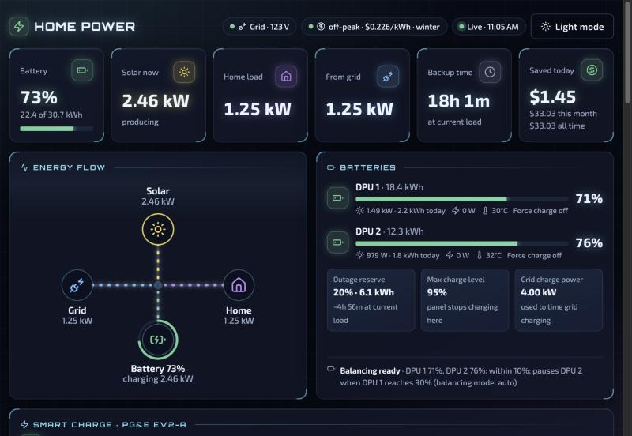
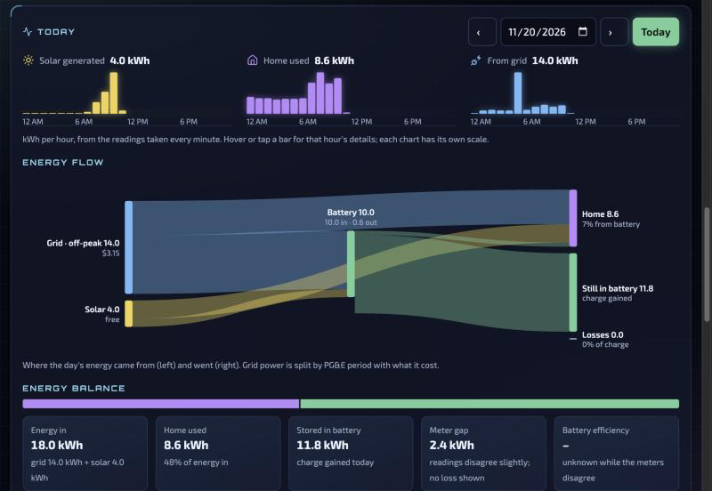

# Home Power

A smarter controller for an **EcoFlow Smart Home Panel 2** with **DELTA Pro Ultra** batteries. It watches the panel every minute, plans grid charging from the solar forecast, keeps two battery stacks balanced, and shows everything on one dashboard.



## Why

EcoFlow's built-in modes work for a simple setup. They fall short when:

- **The two stacks differ.** If they have different capacities or get different sun, one fills up and wastes solar while the other still has room.
- **The weather changes.** The panel doesn't use a forecast, so on a cloudy day the battery can run out before the expensive evening hours end.
- **The panel acts on its own.** Storm mode and the panel's own solar reserve can charge from the grid at 8 kW, and the panel sometimes ignores a "stop charging" command.

## What it does

- **Plans each day from the forecast.** It estimates your solar from the [Open-Meteo](https://open-meteo.com) forecast and from what your panels have actually produced. If that won't carry the house through peak hours, it charges from the grid during cheap off-peak hours, and only as much as the evening needs.
- **Balances two stacks.** When one stack is much fuller or about to overflow with solar, it pauses the other, so the house draws from the fuller one.
- **Catches the panel.** If the panel charges from the grid without being told to, or ignores a stop command, the controller sets it back and logs it.
- **Raises the reserve before wind.** When strong gusts are forecast, it keeps extra charge in case the power goes out.
- **Reports every day:** solar, battery, grid, home use, losses and money saved.




## Before you start

- **Hardware:** a Smart Home Panel 2 with one or two DELTA Pro Ultra stacks. Other EcoFlow panels use different commands and won't work without changes.
- **An EcoFlow developer account** for an access key and secret key. Apply at [developer.ecoflow.com](https://developer.ecoflow.com); approval can take a few days.
- **Your rate plan:** the prices and hours are **PG&E EV2-A**, in California time. For another plan, edit the rates in `planner.py` and the time zone in `server.py`.
- **Python 3.11+** or **Docker**. Nothing else to install.

## Try it with demo data

No account needed:

```bash
git clone https://github.com/mchwang/ecoflow-master.git
cd ecoflow-master
python3 server.py
```

Open http://127.0.0.1:8787.

## Connect your panel

1. Copy the settings file and add your keys:
   ```bash
   cp .env.example .env
   ```
   Fill in `ECOFLOW_ACCESS_KEY` and `ECOFLOW_SECRET_KEY`. The panel's serial number is found for you. For a Europe account, set `ECOFLOW_HOST=https://api-e.ecoflow.com`.
2. Start it again with `python3 server.py`, open the dashboard, click **Settings**, and enter your latitude, longitude and solar array size in kW.
3. Leave the mode on **Dry-run** for a day or two. In Activity, check what the controller *would* do.
4. Switch to **Auto** when you're happy with it.

Every automation starts in Dry-run. Balancing and battery hold each have their own Off / Dry-run / Auto switch.

## Run it all the time (Docker)

The controller only works while it runs, so put it on an always-on machine: a home server, a NAS or a small cloud server.

```bash
docker build -t home-power .
docker run -d --name home-power -p 8787:8787 -v home-power-data:/data \
  -e ECOFLOW_ACCESS_KEY=... -e ECOFLOW_SECRET_KEY=... \
  -e DASHBOARD_PASSWORD='a long random password' \
  home-power
```

- **Password:** `DASHBOARD_PASSWORD` is required in Docker. Sign in as `admin`, or set `DASHBOARD_USER`.
- **HTTPS:** if the server is reachable from the internet, put it behind HTTPS (a reverse proxy, Coolify, Caddy, etc.).
- **One copy:** run only one copy, so two controllers never fight over the panel.
- **Health check:** `/healthz`.

## Important

- **It controls real equipment.** It turns grid charging on and off and changes your panel's reserve settings. Watch it in Dry-run first, and keep an eye on Activity after switching to Auto.
- **The panel doesn't always obey.** The controller works around the problems we've seen, but EcoFlow can change the panel's behaviour with a firmware update.
- **Turn off Storm Guard** in the EcoFlow app if you don't want the panel charging to full from the grid on its own.
- **Not affiliated with EcoFlow.** It uses EcoFlow's public developer API.

## Learn more

[How it works](docs/how-it-works.md) explains each automation, the panel quirks behind them, the data that's stored, and running more than one copy.

## Run the tests

```bash
python3 -m unittest
```

## Contributing

Issues and pull requests are welcome. By submitting a contribution, you agree it can be distributed under this project's license and that the author may also license it under other terms.

## License

[GNU AGPL v3](LICENSE). You may use, change and share this project. If you share a changed version, or run one as a service for others, you must publish your source code under the same license.
